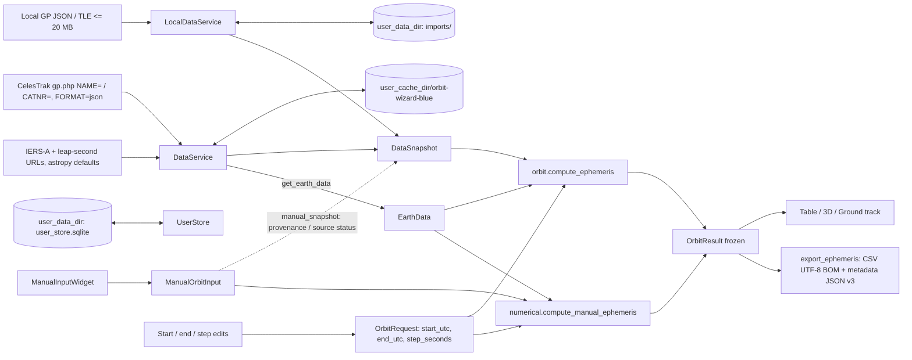

# Codemap: Data Flow

## Stages

1. **Source.** `DataService` requests `https://celestrak.org/NORAD/elements/gp.php` with `NAME` or `CATNR` and `FORMAT=json`, header `User-Agent: orbit-wizard-blue/1.0`, timeout 8 s. IERS-A and leap-second files use astropy's configured URLs (`iers.IERS_A_URL`, `iers.IERS_LEAP_SECOND_URL`).
2. **Cache.** Responses are stored atomically under the cache dir with metadata, `.failure.json` and throttle records; fresh for 7200 s, then revalidated with `If-None-Match` / `If-Modified-Since`. Concurrent refreshes are serialized with `thread_lock` + `process_lock`. A stale cached copy is returned when the source fails.
3. **Validation.** GP JSON passes `validation.gp_items`; TLE text passes `tle.parse_tle`.
4. **Models.** Inputs become frozen `DataSnapshot` / `EarthData`. `OrbitRequest` (`models.py:79-82`) holds only the time grid and is built from the date edits (`gui/window.py:718`). `compute_ephemeris` takes the snapshot, request and earth data; `compute_manual_ephemeris` takes the `ManualOrbitInput` directly (`numerical.py:212-215`).
5. **Compute.** Runs in `TaskWorker` (QThread) with progress and cancel. SGP4 → TEME → GCRS/ITRS/geodetic under `_EARTH_LOCK`, or `solve_ivp` segments ≤ 3600 s with impact/periapsis events.
6. **Output.** `OrbitResult` (read-only arrays) feeds `OrbitTableModel`, `OrbitView`, `GroundTrackView`, and `export_ephemeris`.

## Paths

| Data | Location |
|---|---|
| Provider cache | `platformdirs.user_cache_dir("orbit-wizard-blue")` |
| Recent/favorites DB | `user_data_dir("orbit-wizard-blue")/user_store.sqlite` |
| Imported files | `user_data_dir("orbit-wizard-blue")/imports/` |
| Logs | `ORBIT_WIZARD_LOG_DIR` or `user_log_dir("orbit-wizard-blue")` (rotating file) |
