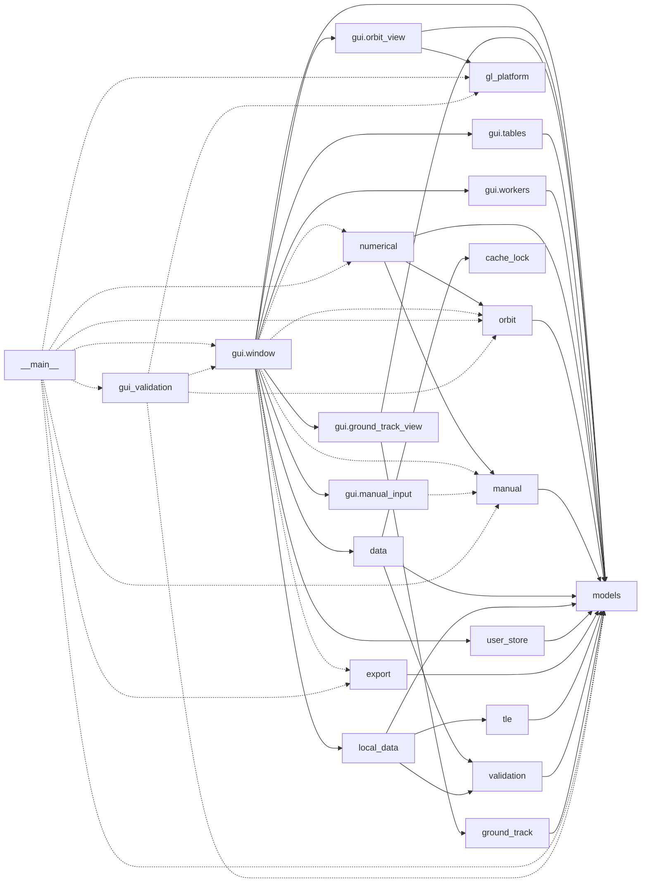

# Codemap: Dependencies

## External packages by importing module

| Package | Imported in |
|---|---|
| PySide6 | `gui/*.py` (module level); function-local: `__main__.py:59-60,158`, `gui_validation.py`, `gl_software_win32.py:18` |
| pyqtgraph | `gui/ground_track_view.py`; function-local: `gui/orbit_view.py:36-37`, `__main__.py:57-58` |
| PyOpenGL (`OpenGL`) | `gl_software_win32.py`; function-local: `gl_platform.py:26,29`, `__main__.py:56`, `gui_validation.py:70,83` |
| numpy | `models.py`, `orbit.py`, `numerical.py`, `ground_track.py`, `gui/orbit_view.py`, `gui/ground_track_view.py` |
| scipy | `numerical.py` (`solve_ivp`) |
| astropy | `orbit.py`, `numerical.py`, function-local: `data.py` (`astropy.utils.iers`), `__main__.py:55,61`, `gui_validation.py:35` |
| pyerfa (`erfa`) | `orbit.py` |
| sgp4 | `orbit.py`, `tle.py` |
| platformdirs | `data.py`, `local_data.py`, `user_store.py`, `__main__.py` |
| requests | none (declared only) |

Standard library highlights: `urllib.request` (HTTP), `sqlite3`, `threading`, `hashlib`, `tempfile`, `csv`, `argparse`, `logging.handlers.RotatingFileHandler`.

## Internal imports

Solid edges are module-level imports; dashed edges are function-local imports.

Compute functions (`compute_ephemeris`, `compute_manual_ephemeris`, `export_ephemeris`) are invoked from `gui/window.py` inside `TaskWorker` tasks and from `__main__.smoke_test`.
