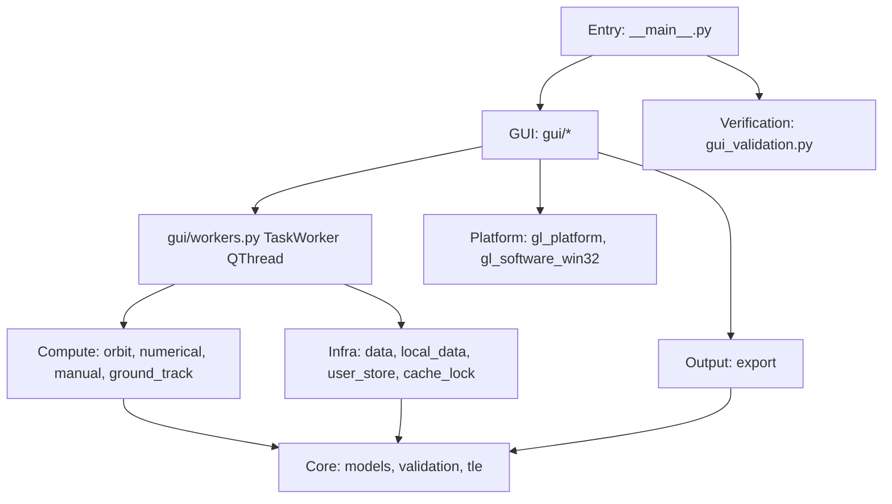

# Codemap: Overview

A layered library with a PySide6 shell. PySide6 is imported at module level only in `gui/*`; `__main__.py` (59-60, 158), `gui_validation.py` and `gl_software_win32.py` (18, to locate the Qt software OpenGL DLL) import it function-locally. Core, compute, infra and output modules do not import Qt.

| Layer | Modules | Boundary rule |
|---|---|---|
| Entry | `__main__.py` | CLI parsing, logging, smoke test; imports GUI lazily for GUI modes |
| GUI | `gui/window.py`, `manual_input.py`, `orbit_view.py`, `ground_track_view.py`, `tables.py`, `workers.py` | only layer importing PySide6 at module level (function-local in `__main__.py`, `gui_validation.py`, `gl_software_win32.py`) |
| Compute | `orbit.py`, `numerical.py`, `manual.py`, `ground_track.py` | no Qt, network or write I/O; `orbit` and `numerical` read local IERS/leap-second files named by `EarthData` (`orbit.py:107-112,165-167`, `numerical.py:101,249-254`); `compute_ephemeris` and `compute_manual_ephemeris` accept `progress`/`cancel` |
| Infra | `data.py`, `local_data.py`, `user_store.py`, `cache_lock.py` | filesystem, network, SQLite |
| Output | `export.py` | atomic file writes |
| Core | `models.py`, `validation.py`, `tle.py` | data types and validation; `models` has no package imports |
| Platform | `gl_platform.py`, `gl_software_win32.py` | PyOpenGL configuration |

Cross-cutting invariants: frozen result dataclasses with read-only arrays; no implicit astropy network access (`iers.conf.auto_download = False`); astropy/ERFA state is guarded by `orbit._EARTH_LOCK` inside computation contexts (`orbit._earth_context`, also used by `numerical`). Not all writes are guarded: `orbit.py:29` sets `iers.conf.auto_download` at import time, and `DataService` writes `iers.conf` without the lock (`data.py:161-165,274`; see tech.md Known Risks).
