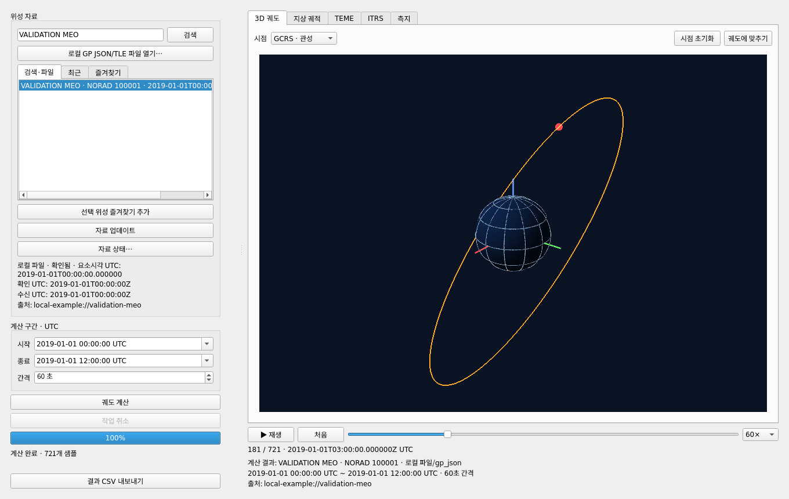
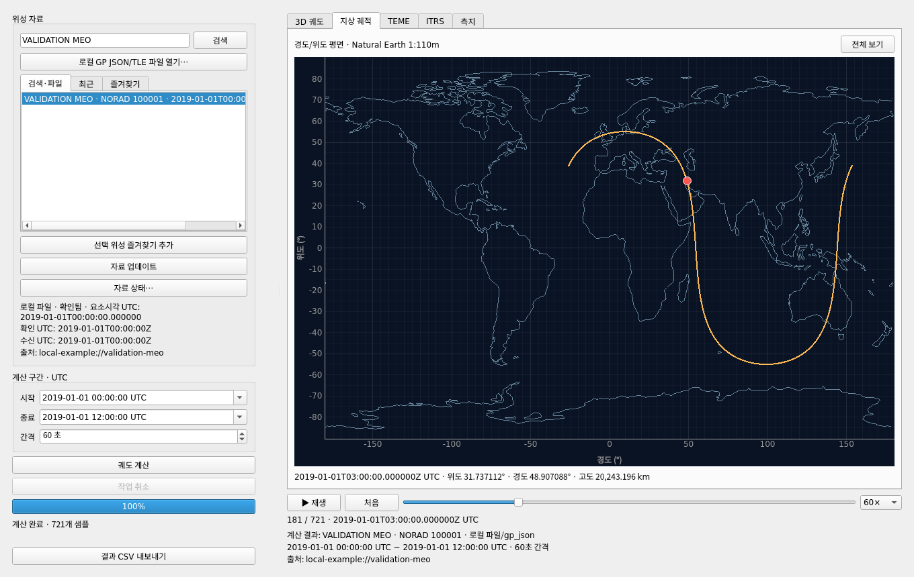
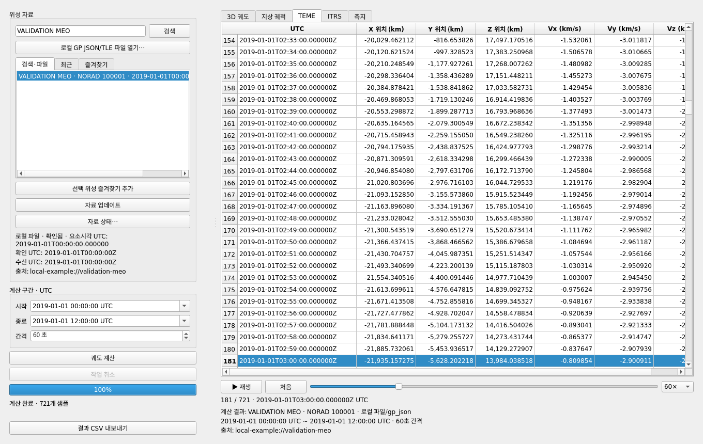
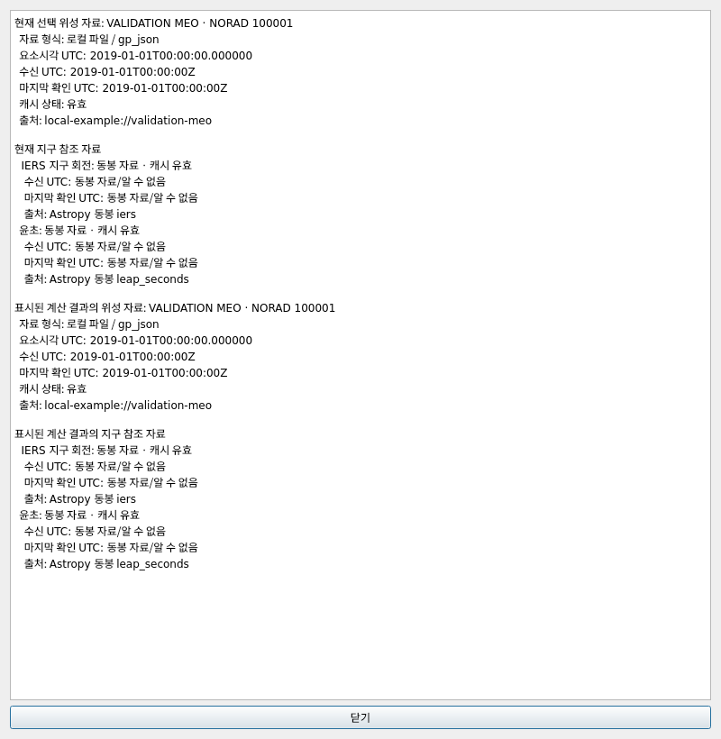

# orbit-wizard-blue

Windows 11 x64용 한국어 위성 궤도 데스크톱 앱입니다. CelesTrak GP JSON에서 공공 위성을 검색하거나 로컬 GP JSON/TLE 파일을 열고, SGP4로 지정된 UTC 구간의 위치와 속도를 계산합니다. TEME·ITRS 결과 표, 측지 위도·경도·고도 표, GCRS 또는 ITRS 3D 궤도, 지상 궤적 지도, CSV와 계산 메타데이터를 제공합니다.

## 앱 화면 미리보기



3D 보기에서는 WGS84 지구·경위도 격자·궤적·선택 샘플의 위성을 함께 확인합니다. 아래 표는 같은 샘플의 UTC와 TEME 위치·속도를 표시합니다.

**지상 궤적** 탭은 오프라인 Natural Earth 해안선 위에 계산된 측지 경로와 선택 샘플의 위치·고도를 보여 줍니다. 날짜변경선을 지나는 궤적은 지도 양끝에서 나누어 표시합니다.





**자료 상태…** 창에서는 현재 자료와 표시 중인 계산 결과에 사용된 위성 요소·IERS·윤초 자료의 출처 및 캐시 상태를 비교할 수 있습니다.



추가 화면: [ITRS 지구 고정 3D 보기](assets/screenshots/itrs-window.png) · [ITRS 위치·속도 결과 표](assets/screenshots/itrs-table.png)

이 화면은 Linux에서 실행한 앱을 **로컬 예제 GP 요소와 동봉 IERS 자료로 계산**해 캡처했습니다. 실제 위성의 관측값을 보여 주는 예시는 아니며, Windows에서는 창 테두리와 글꼴 모양이 다를 수 있습니다. 캡처는 `.venv/bin/python tools/capture_gui.py --output-dir assets/screenshots`로 재생성할 수 있습니다.

## 사용 방법

1. `orbit-wizard-blue.exe`를 실행합니다. ZIP으로 받은 경우 폴더 전체를 먼저 압축 해제하세요.
2. 이름이나 NORAD 번호로 위성을 검색해 결과 하나를 선택하거나 **로컬 GP JSON/TLE 파일 열기…**로 파일을 가져옵니다. 여러 위성이 든 파일은 목록에서 하나를 선택합니다. **최근** 탭에서는 지난 검색/가져오기를 다시 열고, **즐겨찾기** 탭에서는 저장한 위성을 다시 선택할 수 있습니다.
3. UTC 시작·종료 시각과 간격을 확인한 후 **궤도 계산**을 누릅니다. 기본값은 현재 UTC부터 24시간, 60초 간격입니다.
4. 3D 화면을 마우스로 회전·확대하고, **GCRS · 관성** / **ITRS · 지구 고정**을 바꿔 봅니다. **지상 궤적** 탭은 지도 확대·이동과 **전체 보기**를 제공합니다. 지도·3D·슬라이더·표의 행 선택은 동일한 샘플을 가리킵니다. 재생은 1×, 10×, 60×, 600×이며 기본값은 60×입니다. 계산된 샘플 사이의 위성 위치를 보간하지 않습니다.
5. **자료 상태…**에서 현재 위성 요소·IERS·윤초 자료와 표시된 결과에 사용된 자료의 출처·수신/확인 시각·캐시 상태를 확인할 수 있습니다. **결과 CSV 내보내기**는 UTF-8 BOM CSV와 메타데이터 JSON을 저장합니다.

단위는 위치 km, 속도 km/s, 각도 도(°)입니다. 모든 입력·출력 시각은 UTC입니다. CelesTrak 위성 자료와 IERS/윤초 자료는 **2시간 디스크 캐시**에 저장되어 실행 사이에 공유됩니다. 계산을 시작할 때 선택한 온라인 위성 자료의 캐시 만료 여부를 확인하며, 만료된 경우 갱신을 시도합니다. 온라인 즐겨찾기를 열 때도 같은 캐시 정책으로 자료를 확인합니다. 앱의 **자료 업데이트**도 공급자의 2시간 재확인 제한 안에서는 기존 자료를 유지하고 다음 확인 가능 시각을 표시할 수 있습니다. 로컬 파일의 위성 요소는 자동 교체하지 않으며, **자료 업데이트**는 IERS/윤초 자료만 확인합니다. 로컬 위성 요소를 바꾸려면 파일을 명시적으로 다시 가져오세요. 자료나 입력이 바뀌어도 기존 계산 결과는 표시·내보내기 가능하며, 화면의 재계산 알림을 보고 새 조건으로 다시 계산할 수 있습니다. 최신 요소시각에서 멀리 떨어진 예측, 오래된/예측 지구 회전 자료, 제공자 자료 오류는 상태와 결과 경고에 표시됩니다. 인터넷에 접근할 수 없으면 사용 가능한 캐시 또는 동봉된 지구 회전 자료가 사용될 수 있습니다.

가져온 로컬 파일은 전체 검증 후 사용자 데이터 폴더에 복사됩니다. 따라서 원본 파일을 옮겨도 **최근** 및 로컬 **즐겨찾기**에서 다시 열 수 있습니다. 최근 항목은 최대 20개로, 개별 삭제와 전체 지우기를 제공합니다. 즐겨찾기는 목록에서 개별 삭제할 수 있습니다. 앱 시작 때 최근 항목과 즐겨찾기를 표시하는 과정에서는 네트워크에 접속하지 않습니다. CSV 옆의 메타데이터 JSON은 스키마 버전 2이며 `source.kind` (`online`/`local`), `source.format` (`gp_json`/`tle`), 로컬 파일 해시·항목 순서 등의 `source.metadata`, 계산 요청·샘플 범위·사용 자료의 출처를 기록합니다.

## 개발 환경

Python 3.12가 필요합니다. 모든 명령은 저장소 루트에서 실행합니다.

Windows PowerShell:

```powershell
py -3.12 -m venv .venv
.venv\Scripts\python.exe -m pip install -r requirements-dev.txt
.venv\Scripts\python.exe -m pip install --no-deps -e .
.venv\Scripts\python.exe -m orbit_wizard_blue
```

Linux/macOS:

```sh
python3.12 -m venv .venv
.venv/bin/python -m pip install -r requirements-dev.txt
.venv/bin/python -m pip install --no-deps -e .
.venv/bin/python -m orbit_wizard_blue
```

린트와 테스트:

```sh
.venv/bin/python -m ruff check src tests tools
QT_QPA_PLATFORM=offscreen ORBIT_WIZARD_DISABLE_3D=1 .venv/bin/python -m pytest -q
.venv/bin/python -m orbit_wizard_blue --smoke-test
```

Windows에서는 위 명령의 `.venv/bin/python`을 `.venv\Scripts\python.exe`로 바꿉니다. `ORBIT_WIZARD_DISABLE_3D=1`은 OpenGL 없이 GUI 테스트를 실행합니다. 실제 화면과 OpenGL 검사에는 `--gui-check --gui-check-output-dir 출력폴더`를 사용하며, 실행 환경의 그래픽 컨텍스트가 필요합니다.

Windows x64 폴더 ZIP 빌드:

```powershell
.venv\Scripts\python.exe -m PyInstaller --clean --noconfirm orbit-wizard-blue.spec
.\dist\orbit-wizard-blue\orbit-wizard-blue.exe --smoke-test
Compress-Archive -Path dist\orbit-wizard-blue -DestinationPath dist\orbit-wizard-blue-windows-x64.zip
```

`.github/workflows/build.yml`은 push 또는 수동 실행 시 Windows에서 린트·테스트·빌드·실행 파일 기본 검사와 1/1.5/2배 화면 배율의 실제 GUI/OpenGL 검사를 하고 ZIP 아티팩트를 업로드합니다. GUI 검사 보고서와 화면 캡처는 별도 진단 아티팩트로 남습니다. 자동화된 Windows 실행 환경의 검사는 실제 Windows 11 PC와 GPU에서의 동작 검증을 대신하지 않습니다. Linux에서 만든 실행 파일은 Windows용이 아닙니다. `--smoke-test`는 네트워크 접속이나 GUI 창 없이 패키지 import, 로컬 GP JSON→SGP4 변환, IERS 좌표 변환과 CSV 저장을 확인합니다. `--smoke-output 파일명`을 함께 지정하면 검증 상태를 JSON으로 저장합니다.

## 코드 구조

- `src/orbit_wizard_blue/data.py`: CelesTrak/IERS 데이터 접근과 디스크 캐시
- `src/orbit_wizard_blue/local_data.py`, `user_store.py`: 로컬 자료 가져오기와 최근 항목·즐겨찾기 저장
- `src/orbit_wizard_blue/orbit.py`, `models.py`, `export.py`: 전파·좌표 변환·불변 결과·내보내기
- `src/orbit_wizard_blue/ground_track.py`, `assets/`: 날짜변경선 처리와 동봉 Natural Earth 해안선
- `src/orbit_wizard_blue/gui/`: PySide6 화면, 3D·지도 표시, 결과 표, 비동기 작업
- `tests/`: 자동 테스트
- `tools/capture_gui.py`: 오프라인 예제 계산으로 README 화면 캡처 생성
- `assets/screenshots/`: 앱 화면 캡처 이미지
- `orbit-wizard-blue.spec`: PyInstaller 폴더형 배포 설정

Python 코드는 4칸 들여쓰기와 `snake_case` 함수/파일 이름, `PascalCase` 클래스 이름을 사용합니다. 외부 자료 조회와 궤도 계산은 작업 스레드에서 실행하며 3D 렌더링 중 네트워크를 호출하지 않습니다.

앱 실행과 백그라운드 작업 오류의 진단 로그는 운영체제 사용자 로그 디렉터리의 `orbit-wizard-blue/orbit-wizard-blue.log`에 저장됩니다. 파일은 최대 1 MB, 이전 로그 3개까지 보관합니다. 테스트나 별도 실행에서 로그 경로를 바꾸려면 `ORBIT_WIZARD_LOG_DIR` 환경 변수를 지정할 수 있습니다.
